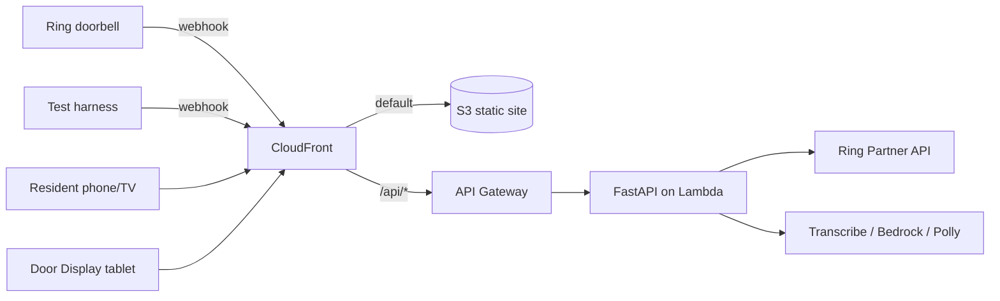

# Threshold

**The front door's interpreter for people who cannot hear, or cannot speak the visitor's language.**

Built for the Amazon Developer Hackathon ("Build, Ship, Shape"), Ring track, plus the AWS Builder and Open Source mini challenges.

**Live demo:** https://d2mvbck7faef3t.cloudfront.net (API health: `/api/health`; Ring webhook: `/api/webhooks/ring`)

> **Status: Phase 4 (policy and replies).** In place:
> - the HMAC-verified Ring webhook, real Ring API client, test harness, DynamoDB store and async worker;
> - live Transcribe and Bedrock perception;
> - the Strands policy agent with deterministic guardrails;
> - Nova Lite + Polly replies for the Door Display, and SNS escalation.
>
> The screens (Phase 5) are next.

## Run the scenarios
```bash
python scripts/run_scenarios.py
```
This runs in-process against real AWS. Add `--url https://d2mvbck7faef3t.cloudfront.net` to run against the deployed stack, and `--replies` to also send a suggested and a custom reply. It prints each card's type, risk, language and per-stage timings, and checks each against the scenario's expectations.

## Try the Ring path
```bash
python scripts/harness.py --url https://d2mvbck7faef3t.cloudfront.net --scenario s1_delivery_hi
```
This POSTs a Ring v1.1-shaped webhook, signed with the test-harness key, to the public webhook URL. The **test harness is our own code, not a Ring simulator.** Threshold labels each event by which key signed it: `ring_api` (Ring's HMAC key) or `test_harness`. With Ring credentials in `.env`, `GET /api/ring/status` calls the real Ring API (`/v1/users/me`, `/v1/devices`).

## What it does
1. Receives a doorbell event from Ring (HMAC-verified webhook) or from our **test harness**. The test harness is our own code, not a Ring simulator.
2. Transcribes and translates the visitor's speech, classifies the visitor, and flags risky pretexts.
3. Shows the resident a visitor card with three safe suggested replies.
4. Shows the resident's reply on a **Door Display** (a tablet by the door) in the visitor's language and speaks it with Polly. Ring has no API for speaking through the doorbell; see [docs/FRICTION_LOG.md](docs/FRICTION_LOG.md) F1.
5. **Never unlocks anything.** High-risk visits escalate to a trusted contact.

## Quickstart (about 5 minutes)

Prerequisites: Python 3.11, Node 20+, AWS CLI v2 and SAM CLI (for deploys only).

```bash
python scripts/tasks.py install
```
```bash
python scripts/tasks.py local
```

Open http://localhost:3000 (UI) and http://localhost:8000/api/health (API). `make <task>` and `.\tasks.ps1 <task>` (Windows) run the same tasks.

| Task | What it does |
|---|---|
| `install` | Creates `.venv`, installs backend and web deps, creates `.env` with a random `DEMO_TOKEN` |
| `local` | Runs the backend on uvicorn :8000 and `next dev` on :3000 |
| `test` | Runs the backend tests |
| `build` | Builds the Lambda bundle (manylinux wheels) and the Next.js static export |
| `deploy` | Runs build, `sam deploy`, syncs the export to S3, invalidates CloudFront, then smoke-tests `/api/health` |
| `outputs` | Prints the site URL, Ring webhook URL and other stack outputs |
| `destroy --yes` | Deletes the stack. **Do not run this before 2026-11-20** (judging period). |

## Architecture



More detail is in [docs/ARCHITECTURE.md](docs/ARCHITECTURE.md) and [docs/AWS_INTEGRATION.md](docs/AWS_INTEGRATION.md).

## Environment variables
See [.env.example](.env.example). The main ones:

| Variable | Purpose |
|---|---|
| `DEMO_TOKEN` | Shared bearer token for non-webhook API routes. **This is demo auth, not production auth.** |
| `AWS_REGION`, `STACK_NAME` | Deploy target (default `us-east-1`, `threshold`) |
| `ALERT_EMAIL`, `MONTHLY_BUDGET_USD` | Account-wide AWS Budget alert |
| `BEDROCK_MODEL_ID`, `BEDROCK_TRANSLATE_MODEL_ID`, `BEDROCK_FALLBACK_MODEL_ID` | Haiku 4.5 (perception), Nova Lite (reply translation), Nova Pro (fallback) |
| `RING_ACCESS_TOKEN` *or* `RING_REFRESH_TOKEN` + `RING_CLIENT_ID` + `RING_CLIENT_SECRET` | Optional real Ring API access |
| `RING_HMAC_KEY` | Verifies Ring webhook signatures |
| `HARNESS_HMAC_KEY` | Signs test-harness webhooks (generated by `install`) |

The deployed demo works **without any Ring credentials**, using the seeded scenarios and the test harness.

## Tests
```bash
python scripts/tasks.py test
```
These include the **no-unlock invariant** (`backend/tests/test_no_unlock.py`), which fails if any model field, enum value, route or tool name suggests unlocking or granting access.

## Cost
Bedrock and Transcribe are the main cost drivers. The stack sets an AWS Budget alert (`MONTHLY_BUDGET_USD`, default 25) and throttles the API to 10 requests/s.

## Seeded vs real
See [docs/SEEDED_DATA.md](docs/SEEDED_DATA.md). Seeded audio and test-harness events are labeled in the UI.

## Privacy
Audio is processed transiently and only text is kept. There is no face recognition and no unlocking. See [docs/PRIVACY.md](docs/PRIVACY.md).

## Limitations
- Ring has no two-way talk API, so replies play on the Door Display, not the doorbell speaker.
- Ring does not document a simulator. Our test harness exercises the same webhook verification code that real Ring traffic uses.
- Local runs use an in-memory store by default; AWS uses DynamoDB.
- The Ring Token Exchange URL (one-way account linking) is not implemented: its request format is only documented as a diagram.

## License
[MIT](LICENSE)
